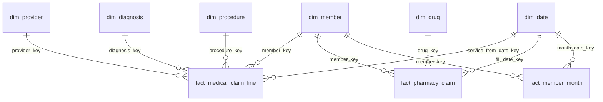

# dbt project

Transforms the raw SynPUF tables into staging, intermediate and mart layers in BigQuery.

## Setup

Run these from the repository root, after the ingestion setup in [ingestion/README.md](../ingestion/README.md).

```bash
.venv/bin/pip install -r requirements-dbt.txt
```

```bash
scripts/dbt.sh deps
```

`scripts/dbt.sh` loads `.env` and points dbt at this folder. `profiles.yml` reads every setting from environment variables, so it holds no secrets.

## Build and test

```bash
scripts/dbt.sh build
```

```bash
scripts/dbt.sh source freshness
```

## Layers

| Layer | Schema | Materialization | Rule |
|---|---|---|---|
| Staging | `staging` | view | One model per source. Rename, cast and clean codes only. |
| Intermediate | `intermediate` | view | Unpivots and joins that marts reuse. |
| Marts | `marts` | table | Facts, dimensions and analytics marts. |

## Staging models

| Model | Grain | Rows (Sample 1, 10%) |
|---|---|---:|
| `stg_synpuf__beneficiaries` | member, coverage year, sample | 34,132 |
| `stg_synpuf__inpatient_claims` | claim segment, sample | 6,683 |
| `stg_synpuf__outpatient_claims` | claim segment, sample | 77,871 |
| `stg_synpuf__carrier_claims` | claim, sample (files A and B combined) | 472,075 |
| `stg_synpuf__prescription_drug_events` | prescription fill, sample | 561,720 |

Repeated source columns, such as 10 diagnosis codes or 13 carrier lines, stay wide in staging with a `_n` suffix. Intermediate models unpivot them.

## Star schema



| Table | Grain | Rows (Sample 1, 10%) |
|---|---|---:|
| `fact_medical_claim_line` | one claim line: carrier line, or inpatient/outpatient claim segment | 1,021,603 |
| `fact_pharmacy_claim` | one prescription fill | 561,720 |
| `fact_member_month` | one member, sample and calendar month of a coverage year | 409,584 |
| `dim_member` | one member coverage version (SCD Type 2) | 22,527 |
| `dim_provider` | one provider ID and type (institution or physician) | 229,035 |
| `dim_diagnosis` | one ICD-9-CM diagnosis code | 11,440 |
| `dim_procedure` | one procedure code and code system (HCPCS or ICD-9-CM) | 7,600 |
| `dim_drug` | one National Drug Code | 196,585 |
| `dim_date` | one calendar day, 2007 to 2011 | 1,827 |

Dimension counts include the unknown row.

Every dimension except `dim_member` has an unknown row (key `'-1'`, or `-1` for dates), so a missing code never drops a fact row.

### Design choices

| Choice | Why |
|---|---|
| SCD Type 2 member history from window functions, not `dbt snapshot` | The sandbox blocks DML, which snapshots need. The yearly files already hold the history, so gaps-and-islands rebuilds it deterministically on every run. |
| Facts pick the member version valid on the service date | Cost analysis must use the coverage a member had at the time. If no version covers the date, the fact uses the latest version and sets `is_member_version_matched = false`. |
| Institutional claims are one row per claim segment | SynPUF has no line-level payments for inpatient or outpatient claims, and splitting the claim payment across lines would invent data. |
| Carrier lines unpivoted in one scan | A cross join with 13 line numbers reads the table once. A 13-way `UNION ALL` would read it 13 times and exceed the 2 GB query cap. |
| `fact_medical_claim_line` partitioned by integer `service_year_month`, clustered by `member_key` | The sandbox deletes date partitions older than 60 days on load, so a date partition would lose every 2008 to 2010 row. An integer range keeps them. |
| Enrollment months run from January forward | SynPUF only reports months of coverage per year. The assumption is documented in `fact_member_month`. |

### What the build showed

- **Paid amounts reconcile exactly.** Raw and fact totals match for carrier ($41,236,860), inpatient ($63,632,290), outpatient ($22,504,820) and pharmacy gross cost ($34,474,750).
- **Member history:** 11,550 members have 22,527 versions. 3,994 have one version, 4,135 have two and 3,421 have three.
- **Member version fallback:** 1,242 medical lines use the latest member version. 1,175 have no service date, and 67 are claims that start in December 2007, before the first coverage year.
- **Partitions:** 37 monthly partitions (December 2007 to December 2010) plus a null partition holding the 1,175 lines without a service date.

## Analytics marts

Built only from the star schema, and read by the dashboard.

| Mart | Grain | What it answers |
|---|---|---|
| `mart_cost_pmpm` | calendar month | Medical and pharmacy cost per member per month |
| `mart_utilization` | calendar month | Inpatient admissions, outpatient visits and professional claims per 1,000 members |
| `mart_top_diagnoses` | primary diagnosis | Total paid, claims and members, ranked by cost and by members |
| `mart_pharmacy_spend` | National Drug Code | Fills, members and spend, ranked by gross cost |
| `mart_high_cost_members` | member and plan year | Members above the 95th percentile of annual cost |

PMPM and utilization marts keep their inputs (cost, counts and member months). Roll up to a year by summing inputs first, for example `sum(medical_paid_amount) / sum(medical_member_months)`, never by averaging monthly rates.

### Definitions

| Measure | Definition |
|---|---|
| Medical cost | Medicare paid amount on medical claim lines (`paid_amount`) |
| Pharmacy cost | Plan paid: gross drug cost minus patient pay |
| Member months | From `fact_member_month`: Part A or B months for medical, Part D months for pharmacy |
| Admissions, visits | Distinct inpatient, outpatient or carrier claims, in the month the claim starts |
| Per 1,000 | count / medical member months × 12,000 (annualized) |
| High cost | `percent_rank` of total annual cost above 0.95 among members enrolled that year, including members with no claims |

### Results (Sample 1, 10% of members)

| Plan year | Medical PMPM | Pharmacy PMPM | Admissions per 1,000 | Outpatient visits per 1,000 |
|---|---:|---:|---:|---:|
| 2008 | $363.07 | $130.13 | 247.6 | 2,599.7 |
| 2009 | $393.20 | $109.05 | 245.2 | 2,970.2 |
| 2010 | $223.51 | $65.34 | 131.6 | 1,621.0 |

| Plan year | High-cost members | Enrolled members | Threshold | Share of annual cost | Avg chronic conditions (all members) |
|---|---:|---:|---:|---:|---:|
| 2008 | 558 | 11,144 | $21,290 | 40% | 6.56 (2.23) |
| 2009 | 544 | 10,880 | $21,410 | 33% | 6.18 (2.57) |
| 2010 | 535 | 10,711 | $12,040 | 35% | 4.20 (1.79) |

Top diagnoses by cost: coronary atherosclerosis (414.01), septicemia (038.9), rehabilitation (V57.89), pneumonia (486) and localized osteoarthritis of the lower leg (715.36).

### Data caveats

- **2010 is lower.** Claims starting in 2010 drop by about 40 to 50% against 2009 for every claim type, while enrollment stays flat. The drop is in the source files, not the models, so 2010 PMPM and utilization should not be read as a real trend.
- **Drug-level spend is flat.** Sample 1 has 196,584 distinct NDCs, 70,500 of them filled once, and the top drugs tie. SynPUF scrambles drug detail, so `mart_pharmacy_spend` shows the mechanics, not real drug rankings.
- **Code descriptions.** ICD-9 titles come from the CMS Version 32 files (`scripts/build_icd9_seeds.py`). Diagnoses with a title cover 97.3% of diagnosis-attributed cost. The 407 codes without one are mostly non-billable category codes, such as `0058`. All 600 five-character values in SynPUF's ICD-9 procedure fields lack titles, because real ICD-9-CM procedure codes have at most four digits. HCPCS codes have no titles, because CPT descriptions are copyrighted by the AMA.

## Data quality

Business rules flag records and keep them. Nothing is dropped.

| Part | Where | What it does |
|---|---|---|
| Rule list | `macros/data_quality.sql` | Each rule's name, fact, flag column, reason and maximum violation rate, defined once |
| Flags | `dq_` columns and `has_dq_issue` on both facts | Marks each failing record |
| Quarantine | `quality.dq_quarantine` | One row per failing record and rule, with the reason |
| Rule summary | `quality.dq_rule_summary` | Violation count and rate per rule against its threshold |
| Threshold test | `dq_rule_violation_rate_within_threshold` | Fails the build when any rule goes above its threshold |
| Reconciliation | `tests/singular/assert_raw_paid_reconciles_to_facts.sql` | Raw paid per claim type, summed straight from the source tables, equals the facts within one cent |
| Reconciliation | `tests/singular/assert_pmpm_mart_reconciles_to_facts.sql` | PMPM mart cost plus the cost it leaves out equals the facts within one cent |

Thresholds sit at about two to three times the rate measured on Sample 1, or at zero for rules that never fired. That way the known quirks of the synthetic data pass, but a real regression fails the build.

| Rule | Fact | Violations | Rate | Threshold |
|---|---|---:|---:|---:|
| Negative paid amount | medical | 246 | 0.02% | 0.1% |
| Missing service date | medical | 1,175 | 0.12% | 0.5% |
| Service start after end | medical | 0 | 0% | 0% |
| Member not enrolled in service month | medical | 6,919 | 0.68% | 2% |
| Negative drug cost | pharmacy | 0 | 0% | 0% |
| Patient pay above gross drug cost | pharmacy | 29,183 | 5.2% | 10% |
| Zero days supply | pharmacy | 11,763 | 2.1% | 5% |
| Member not enrolled in Part D month | pharmacy | 8,482 | 1.5% | 3% |

The enrollment rules rely on the January-forward month assumption (D4), so some of those flags are an artifact of the source reporting month counts rather than monthly enrollment.

**Proof the checks work:** running with `--vars '{dq_max_rate_scale: 0}'` sets every threshold to zero, and the threshold test failed on exactly the 6 rules that have violations. Raw and fact totals match to the cent: inpatient $63,632,290, outpatient $22,504,820, carrier $41,236,860 and pharmacy gross cost $34,474,750.

## Tests

| Check | Where | What it catches |
|---|---|---|
| `columns_castable` | raw sources | Any non-blank date, integer or amount that would silently become null when cast. |
| Unique keys | every staging model | Duplicate members per year, claim segments, carrier claims or fills. |
| `relationships` | claims and fills | A member ID that is missing from every beneficiary year. |
| Accepted values and ranges | beneficiaries | Unknown sex or race codes, coverage months outside 0 to 12. |
| Freshness | `raw._ingest_runs` | No ingestion run in 26 hours (warn) or 50 hours (error). |

Star schema tests add primary keys on every fact and dimension, a relationship test for every fact foreign key, row-count checks between facts and their inputs, and two SCD Type 2 checks: one current version per member and no overlapping versions.

The latest full build passed 181 checks with 3 warnings. The warnings are real source issues, reported and kept rather than dropped:

| Warning | Rows |
|---|---:|
| Inpatient claims with no `claim_from_date` | 3 |
| Outpatient claims with no `claim_from_date` | 1,172 |
| Drug events whose product code is not 11 characters | 3 |

Profiling also found 6 inpatient and 240 outpatient claims with negative payments. Business-rule tests in the marts will flag these.

## Cost guardrails

- `maximum_bytes_billed` in `profiles.yml` fails any query that would scan more than 2 GB.
- A full `dbt build` (23 models, 2 seeds, 148 tests) processed 1,678 MB and billed 3,351 MB. BigQuery bills at least 10 MB per query, so the many small test queries add up.
- At one build a day, that is about 100 GB a month, or 10% of the sandbox's 1 TiB monthly query allowance.

## Portability

Warehouse-specific SQL is isolated in `macros/casting.sql`. For example, `parse_yyyymmdd` uses `safe.parse_date` on BigQuery and `try_to_date` elsewhere, so the same models can run on Snowflake.
